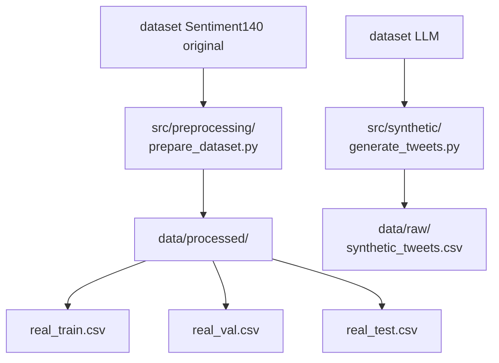
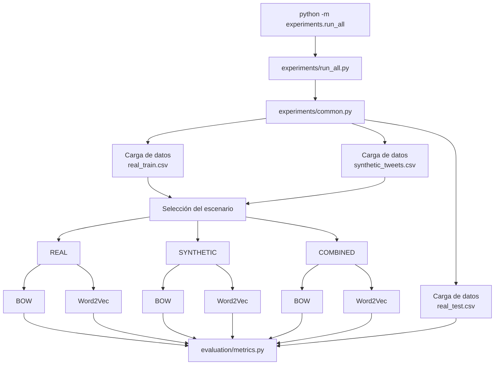
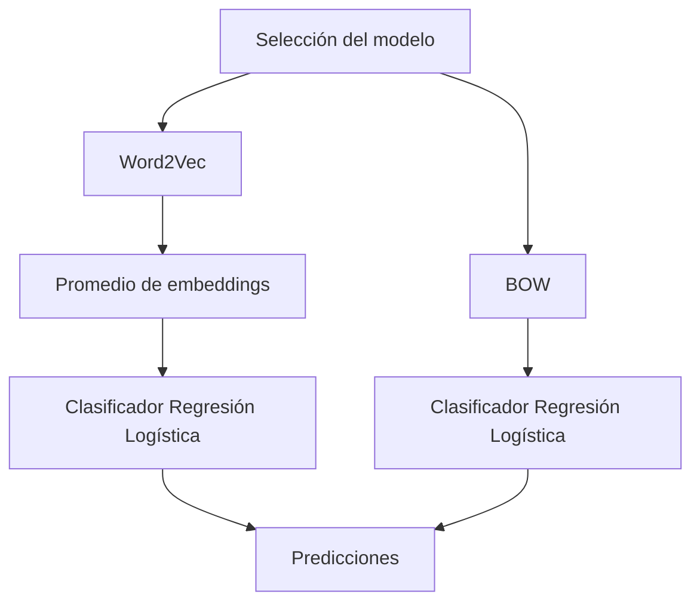
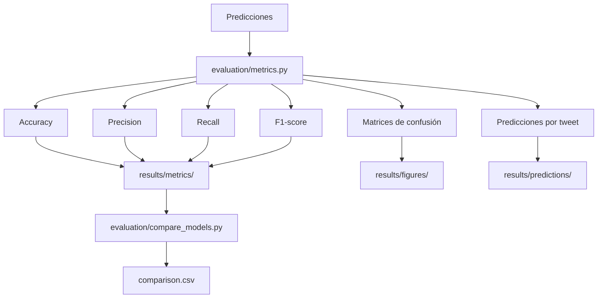

# analisis-sentimientos
Análisis de sentimientos mediante técnicas de procesamiento del lenguaje natural, utilizando el conjunto de datos Sentiment140 de Stanford y un database generado con IA (solo en train), comparando bag Of Words y Word2Vec, empleando para ambos clasificación mediante Regresión Logística.


# ejecutar

## instalar requirements
python3 -m venv venv_analisis_sentimiento
source venv_analisis_sentimiento/bin/activate
pip install -r requirements.txt

## ejecuta experiments y compare_models
rm -f results/metrics/*.csv
python -m experiments.run_all

# Flujo de ejecución del proyecto

## 1. Preparación de los datos



## 2. Como funciona la ejecución de los experimentos



## 3. Cuales son los modelos utilizados



## 4. Evaluación y resultados



## 5. Estructura de resultados

```text
results/
│
├── metrics/
│   ├── bow_real.csv
│   ├── bow_synthetic.csv
│   ├── bow_combined.csv
│   ├── word2vec_real.csv
│   ├── word2vec_synthetic.csv
│   ├── word2vec_combined.csv
│   └── comparison.csv
│
├── figures/
│   ├── bow_real_confusion.png
│   ├── bow_synthetic_confusion.png
│   ├── bow_combined_confusion.png
│   ├── word2vec_real_confusion.png
│   ├── word2vec_synthetic_confusion.png
│   └── word2vec_combined_confusion.png
│
└── predictions/
    ├── bow_real_predictions.csv
    ├── bow_synthetic_predictions.csv
    ├── bow_combined_predictions.csv
    ├── word2vec_real_predictions.csv
    ├── word2vec_synthetic_predictions.csv
    └── word2vec_combined_predictions.csv
```